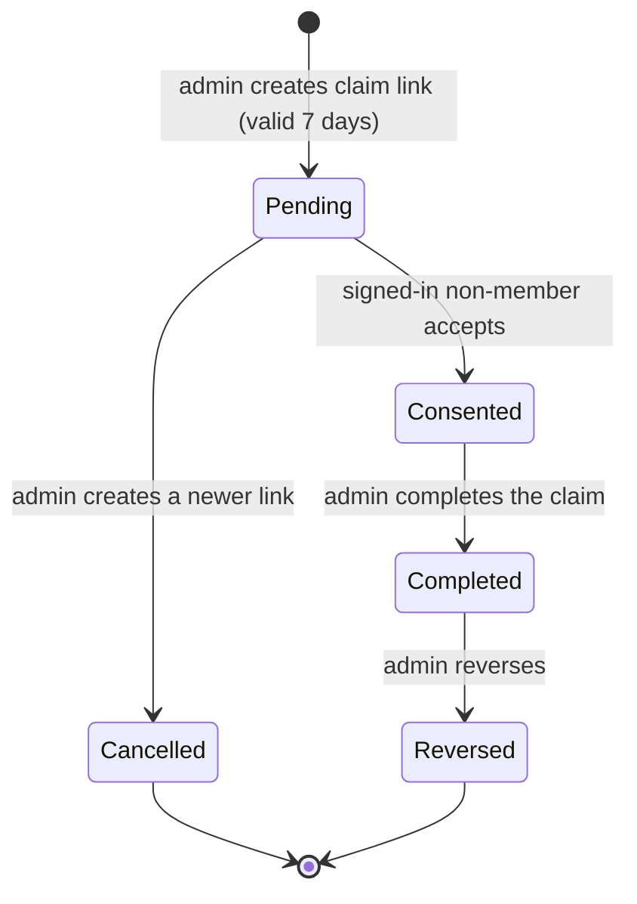

# 02 · Roles

## Purpose

Who uses PitchMate and what each of them may do. The permission matrix is taken from the authorisation check inside each use case, not from the UI, because the backend is what enforces it. Read this before adding an action or changing who may perform one.

## Today (as-is)

### The user types

| User type | Status | What it is today | Source |
|---|---|---|---|
| **Visitor** | **Built** | Not signed in. Can reach the landing page and the auth screens, register, sign in, reset a password and verify an email. Sees no squad data | `backend/src/PitchMate.Api/Auth/Endpoints/AuthEndpoints.cs:53`, `backend/src/PitchMate.Api/Squads/Endpoints/SquadEndpoints.cs:391` |
| **Signed-in user (no squad)** | **Built** | Has an account but no membership. Can create a squad (becoming its owner), redeem an invite, accept a guest claim, and manage their own account | `backend/src/PitchMate.Application/Squads/UseCases/CreateSquadHandler.cs`, `backend/src/PitchMate.Application/Squads/UseCases/RedeemInviteHandler.cs` |
| **Member** | **Built** | An active `SquadMembership` with role `Member`. Reads everything in the squad, marks their own availability, joins and leaves matches | `backend/src/PitchMate.Domain/Squads/SquadRole.cs`, `backend/src/PitchMate.Application/Matches/MatchAuthorization.cs` |
| **Admin** | **Built** | Role `Admin`. Everything a member can do, plus organising matches, managing people, guests, invites and features | `backend/src/PitchMate.Application/Squads/SquadAuthorization.cs` |
| **Owner** | **Built** | Role `Owner`; exactly one per squad, enforced by a unique index. Everything an admin can do, plus transfer, delete, restore and export | `backend/src/PitchMate.Application/Squads/SquadAuthorization.cs`, `backend/src/PitchMate.Infrastructure/Persistence/Configurations/Squads/SquadMembershipConfiguration.cs` |
| **Guest** | **Built** | A membership with no user and no role, created by an admin. Cannot sign in or act; is selected, balanced, rated and shown in stats like anyone else | `backend/src/PitchMate.Domain/Squads/SquadMembership.cs`, `backend/src/PitchMate.Application/Squads/UseCases/CreateGuestHandler.cs:78` |
| **Claimed guest** | **Built** | A guest membership rebound to a registered user through a claim. The same membership row, so rating and stats carry over; from then on it behaves as a member | `backend/src/PitchMate.Domain/Squads/GuestClaim.cs`, `backend/src/PitchMate.Application/Squads/UseCases/CompleteGuestClaimHandler.cs:78` |
| **Inactive member** | **Built** | Left or removed. Fails every squad gate (so the squad looks as if it does not exist) but can still read their own notifications. Re-joining reactivates the same membership | `backend/src/PitchMate.Domain/Squads/MembershipState.cs`, `backend/src/PitchMate.Application/Notifications/NotificationAuthorization.cs` |

"Organiser" in the code means owner or admin (`backend/src/PitchMate.Application/Matches/MatchAuthorization.cs`).

### Permission matrix

✓ = allowed, – = refused. A refusal on a squad the caller cannot see is concealed as a 404 (see [07 · Trust](07-trust.md)). Guests never act, so they have no column; the "on behalf of a guest" rows show who acts for them. Every row is **Built** unless tagged otherwise.

#### Account

| Action | Visitor | Signed-in | Source |
|---|---|---|---|
| Register with email and password (12–128 characters) | ✓ | – | `backend/src/PitchMate.Api/Auth/Endpoints/AuthEndpoints.cs:53`, `backend/src/PitchMate.Domain/Auth/PasswordPolicy.cs` |
| Sign in with password or Google | ✓ | – | `backend/src/PitchMate.Api/Auth/Endpoints/AuthEndpoints.cs:63`, `backend/src/PitchMate.Api/Auth/Endpoints/AuthEndpoints.cs:73` |
| Request and redeem a password reset; redeem an email verification | ✓ | ✓ | `backend/src/PitchMate.Api/Auth/Endpoints/AuthEndpoints.cs:94`, `backend/src/PitchMate.Api/Auth/Endpoints/AuthEndpoints.cs:115` |
| View own account, sign out, resend verification | – | ✓ | `backend/src/PitchMate.Api/Auth/Endpoints/AuthEndpoints.cs:135`, `backend/src/PitchMate.Api/Auth/Endpoints/AuthEndpoints.cs:153` |
| Link Google, add a password, unlink a sign-in method (never the last one) | – | ✓ | `backend/src/PitchMate.Api/Auth/Endpoints/AuthEndpoints.cs:163`, `backend/src/PitchMate.Api/Auth/Endpoints/AuthEndpoints.cs:195` |
| Erase own account; export own data | – | ✓ | `backend/src/PitchMate.Api/Auth/Endpoints/AuthEndpoints.cs:229`, `backend/src/PitchMate.Api/Auth/Endpoints/AuthEndpoints.cs:247` |
| Change own account display name — **Gap**: the domain method exists but no use case or endpoint calls it | – | – | `backend/src/PitchMate.Domain/Auth/User.cs` |

#### Squad and people

| Action | Signed-in, not a member | Member | Admin | Owner | Source |
|---|---|---|---|---|---|
| Create a squad (creator becomes owner) | ✓ | ✓ | ✓ | ✓ | `backend/src/PitchMate.Application/Squads/UseCases/CreateSquadHandler.cs` |
| Redeem an invite and join (or re-join) | ✓ | – | – | – | `backend/src/PitchMate.Application/Squads/UseCases/RedeemInviteHandler.cs` |
| Accept a guest claim link | ✓ | – | – | – | `backend/src/PitchMate.Application/Squads/UseCases/AcceptGuestClaimHandler.cs` |
| Read the squad, its players and its feature settings | – | ✓ | ✓ | ✓ | `backend/src/PitchMate.Application/Squads/UseCases/GetSquadHandler.cs:90`, `backend/src/PitchMate.Application/Squads/UseCases/GetFeatureFlagsHandler.cs:48` |
| Leave the squad | – | ✓ | ✓ | – (must transfer first) | `backend/src/PitchMate.Application/Squads/UseCases/LeaveSquadHandler.cs` |
| Generate, list and revoke invites | – | – | ✓ | ✓ | `backend/src/PitchMate.Application/Squads/UseCases/GenerateInviteHandler.cs:87`, `backend/src/PitchMate.Application/Squads/UseCases/RevokeInviteHandler.cs:68` |
| Promote a member to admin | – | – | ✓ | ✓ | `backend/src/PitchMate.Application/Squads/UseCases/PromoteToAdminHandler.cs:71` |
| Demote an admin to member (an admin may demote another admin) | – | – | ✓ | ✓ | `backend/src/PitchMate.Application/Squads/UseCases/DemoteToMemberHandler.cs:49` |
| Remove a member or guest (an admin may remove an admin; nobody removes the owner) | – | – | ✓ | ✓ | `backend/src/PitchMate.Application/Squads/UseCases/RemoveMemberHandler.cs:74` |
| Turn an optional feature on or off | – | – | ✓ | ✓ | `backend/src/PitchMate.Application/Squads/UseCases/SetFeatureFlagHandler.cs:56` |
| Create a guest (with the lawful-basis acknowledgement); edit a guest's name and skill tier | – | – | ✓ | ✓ | `backend/src/PitchMate.Application/Squads/UseCases/CreateGuestHandler.cs:78`, `backend/src/PitchMate.Application/Squads/UseCases/EditGuestHandler.cs:75` |
| Create a claim link, see claim status, complete a claim, reverse a claim | – | – | ✓ | ✓ | `backend/src/PitchMate.Application/Squads/UseCases/InitiateGuestClaimHandler.cs:71`, `backend/src/PitchMate.Application/Squads/UseCases/CompleteGuestClaimHandler.cs:78`, `backend/src/PitchMate.Application/Squads/UseCases/ReverseGuestClaimHandler.cs:75` |
| Transfer ownership (to an active registered member) | – | – | – | ✓ | `backend/src/PitchMate.Application/Squads/UseCases/TransferOwnershipHandler.cs:76` |
| Delete the squad (soft, with grace period); restore it; export it | – | – | – | ✓ | `backend/src/PitchMate.Application/Squads/UseCases/DeleteSquadHandler.cs:76`, `backend/src/PitchMate.Application/Squads/UseCases/ReverseSquadDeletionHandler.cs:71`, `backend/src/PitchMate.Application/Squads/UseCases/ExportSquadHandler.cs:69` |
| Rename the squad — **Gap**: no use case | – | – | – | – | `backend/src/PitchMate.Domain/Squads/Squad.cs` |
| Change a registered member's squad display name — **Gap**: only guests can be renamed | – | – | – | – | `backend/src/PitchMate.Application/Squads/UseCases/EditGuestHandler.cs` |

#### Matches

| Action | Member | Admin | Owner | Source |
|---|---|---|---|---|
| See the match list, a match, the availability tally and the team sheet | ✓ | ✓ | ✓ | `backend/src/PitchMate.Application/Matches/UseCases/GetMatchListHandler.cs:78`, `backend/src/PitchMate.Application/Matches/UseCases/GetMatchDetailHandler.cs:68`, `backend/src/PitchMate.Application/Matches/UseCases/GetTeamSheetHandler.cs:81` |
| Mark or clear their own availability | ✓ | ✓ | ✓ | `backend/src/PitchMate.Application/Matches/UseCases/SubmitAvailabilityResponseHandler.cs:119` |
| Join or leave a confirmed match themselves | ✓ | ✓ | ✓ | `backend/src/PitchMate.Application/Matches/UseCases/JoinMatchHandler.cs:61`, `backend/src/PitchMate.Application/Matches/UseCases/LeaveMatchHandler.cs:56` |
| Create a match draft | – | ✓ | ✓ | `backend/src/PitchMate.Application/Matches/UseCases/CreateMatchDraftHandler.cs:111` |
| Mark or clear availability on behalf of a guest; see guests' marked days | – | ✓ | ✓ | `backend/src/PitchMate.Application/Matches/UseCases/SetGuestAvailabilityHandler.cs:78`, `backend/src/PitchMate.Application/Matches/UseCases/GetMatchDetailHandler.cs:89` |
| Confirm the match on a candidate day | – | ✓ | ✓ | `backend/src/PitchMate.Application/Matches/UseCases/ConfirmMatchHandler.cs:142` |
| Add or remove any player, member or guest | – | ✓ | ✓ | `backend/src/PitchMate.Application/Matches/UseCases/AddParticipantHandler.cs:105`, `backend/src/PitchMate.Application/Matches/UseCases/RemoveParticipantHandler.cs:99` |
| Roll teams, see the working teams, move a player, re-roll, name teams, choose the bib team | – | ✓ | ✓ | `backend/src/PitchMate.Application/Matches/UseCases/ProposeTeamsHandler.cs:106`, `backend/src/PitchMate.Application/Matches/UseCases/AdjustTeamsHandler.cs:109`, `backend/src/PitchMate.Application/Matches/UseCases/GetWorkingTeamsHandler.cs:77` |
| Lock and unlock teams | – | ✓ | ✓ | `backend/src/PitchMate.Application/Matches/UseCases/LockTeamsHandler.cs:119`, `backend/src/PitchMate.Application/Matches/UseCases/UnlockTeamsHandler.cs:83` |
| Start the match; undo kickoff | – | ✓ | ✓ | `backend/src/PitchMate.Application/Matches/UseCases/StartMatchHandler.cs:95`, `backend/src/PitchMate.Application/Matches/UseCases/UndoMatchStartHandler.cs:90` |
| Record a result; complete the match; cancel the match | – | ✓ | ✓ | `backend/src/PitchMate.Application/Matches/UseCases/RecordResultHandler.cs:104`, `backend/src/PitchMate.Application/Matches/UseCases/CompleteMatchHandler.cs:171`, `backend/src/PitchMate.Application/Matches/UseCases/CancelMatchHandler.cs:97` |

#### Live tracking, stats and notifications

| Action | Member | Admin | Owner | Source |
|---|---|---|---|---|
| See the live score and the event log | ✓ | ✓ | ✓ | `backend/src/PitchMate.Application/LiveTracking/UseCases/GetRunningScoreHandler.cs:97`, `backend/src/PitchMate.Application/LiveTracking/UseCases/GetMatchEventsHandler.cs:83` |
| Record live events (goals, undo, keeper changes); end the match from the tracker | – | ✓ | ✓ | `backend/src/PitchMate.Application/LiveTracking/UseCases/RecordEventBatchHandler.cs:123`, `backend/src/PitchMate.Application/LiveTracking/UseCases/FinaliseTrackedResultHandler.cs:121` |
| See the squad leaderboards and any player's profile, guests included | ✓ | ✓ | ✓ | `backend/src/PitchMate.Application/Stats/GetLeaderboardHandler.cs:57`, `backend/src/PitchMate.Application/Stats/GetPlayerProfileHandler.cs:93` |
| Read and mark their own notifications | ✓ | ✓ | ✓ | `backend/src/PitchMate.Application/Notifications/ListNotificationsHandler.cs:53`, `backend/src/PitchMate.Application/Notifications/MarkNotificationReadHandler.cs:66` |

### Guest to claimed guest

- **Built** · Claim states and the 7-day validity. `backend/src/PitchMate.Domain/Squads/GuestClaimState.cs`, `backend/src/PitchMate.Domain/Squads/GuestClaim.cs`
- **Built** · A new link cancels the open one. `backend/src/PitchMate.Application/Squads/UseCases/InitiateGuestClaimHandler.cs`
- **Built** · Someone who already belongs to the squad cannot accept. `backend/src/PitchMate.Application/Squads/UseCases/AcceptGuestClaimHandler.cs`
- **Built** · Completing rebinds the same membership to the user, so rating and stats are preserved; reversing unbinds it. `backend/src/PitchMate.Domain/Squads/SquadMembership.cs`
- **Partial** · "The claim is audited": the claim row stores when it was accepted, completed, reversed and cancelled, plus the generic created-by/updated-by columns, but there is no separate audit log. `backend/src/PitchMate.Infrastructure/Persistence/Configurations/Squads/GuestClaimConfiguration.cs`

## Rules

- **Built** · Exactly one owner per squad, held by a unique database index; transfer swaps both roles in one transaction. `backend/src/PitchMate.Infrastructure/Persistence/Configurations/Squads/SquadMembershipConfiguration.cs`, `backend/src/PitchMate.Application/Squads/UseCases/TransferOwnershipHandler.cs`
- **Built** · The owner cannot leave, be demoted or be removed; they transfer first. `backend/src/PitchMate.Domain/Squads/SquadMembership.cs`
- **Built** · A guest has no user and no role (a database check constraint), and stores only a display name and an optional skill tier. `backend/src/PitchMate.Infrastructure/Persistence/Configurations/Squads/SquadMembershipConfiguration.cs`
- **Built** · Display names are unique within a squad, ignoring case and surrounding spaces, for guests and members alike. `backend/src/PitchMate.Domain/Squads/SquadMembership.cs`, `backend/src/PitchMate.Infrastructure/Persistence/Configurations/Squads/SquadMembershipConfiguration.cs`
- **Built** · Leaving or removal makes the membership inactive and keeps its history; re-joining reactivates the same row, with an admin returning as a member. `backend/src/PitchMate.Domain/Squads/SquadMembership.cs`, `backend/src/PitchMate.Application/Squads/UseCases/RedeemInviteHandler.cs`
- **Built** · The acting user always comes from the access token, never from the request. `backend/src/PitchMate.Api/Auth/Endpoints/CallerIdentity.cs`
- **Built** · Every squad-scoped gate requires an **active** membership, and a failed gate does not reveal whether the squad exists. `backend/src/PitchMate.Application/Squads/SquadAuthorization.cs`

## Open questions

1. **Can an admin demote or remove another admin?** The code allows both (`backend/src/PitchMate.Application/Squads/UseCases/DemoteToMemberHandler.cs:49`, `backend/src/PitchMate.Application/Squads/UseCases/RemoveMemberHandler.cs:74`). `product.md` only says the owner or an admin can promote; it is silent on demotion, which exists in the code.
2. **Who may see guests' marked days?** Only organisers, and only while availability is being gathered (`backend/src/PitchMate.Application/Matches/UseCases/GetMatchDetailHandler.cs:89`). `product.md` does not say; members see the tally.
3. **Should a member be able to rename themselves in a squad, or an owner rename the squad?** Neither exists. A join-time name collision is the only moment a member chooses a squad display name.
4. **Is live tracking admin-only on purpose?** Recording is admin-gated (`backend/src/PitchMate.Application/LiveTracking/UseCases/RecordEventBatchHandler.cs:123`). The watch README imagines several tracking clients; does a non-admin ever track?
5. **Is the claim "audit" enough?** `product.md` says the claim is audited; today that means timestamps on the claim row.
6. **Guest deletion.** There is no "delete guest" action; removal makes the guest inactive, and the erase-membership use case exists but nothing calls it (see [07 · Trust](07-trust.md)).

## Ideas

- **Idea** · A "match organiser" permission an admin can lend to a member for one match (create, roll, track) without making them an admin.
- **Idea** · Let any member in the lineup record live events, with the admin able to correct.
- **Idea** · A read-only "spectator" link to a team sheet or live score for people outside the squad (would need a privacy decision).
- **Idea** · Self-service display-name change within a squad, subject to the uniqueness rule.
