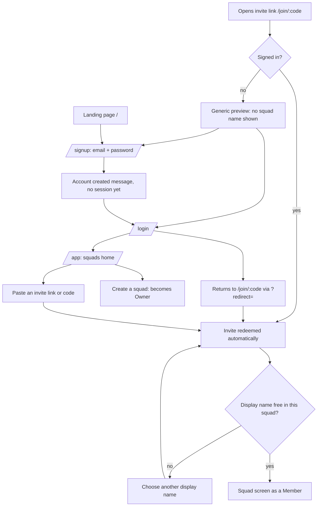
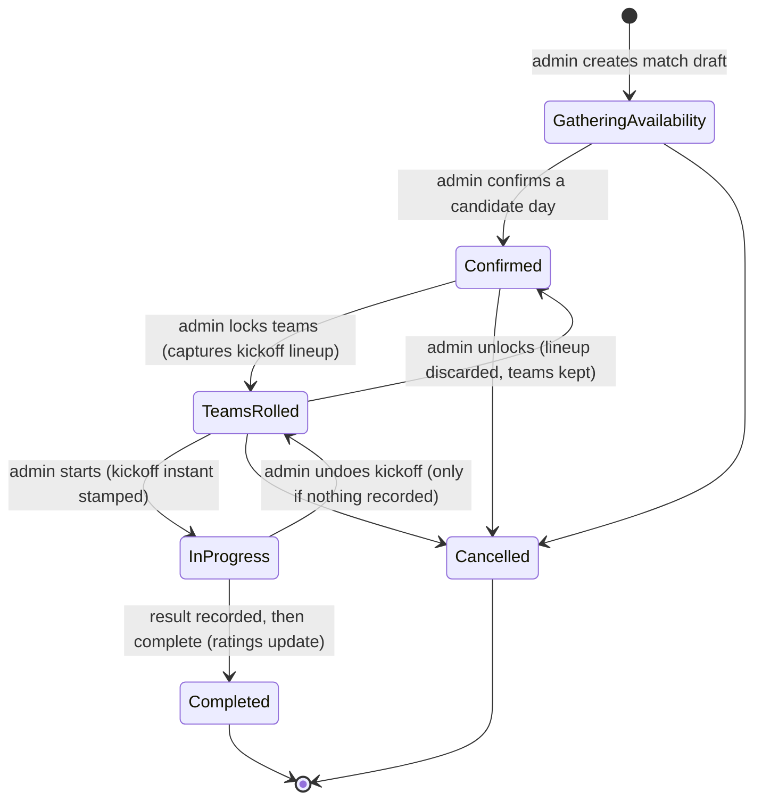
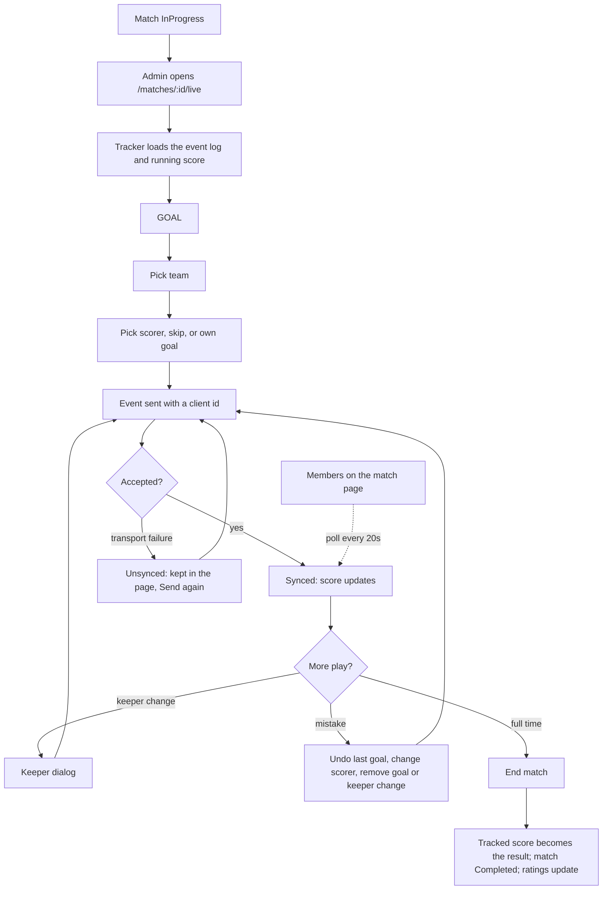
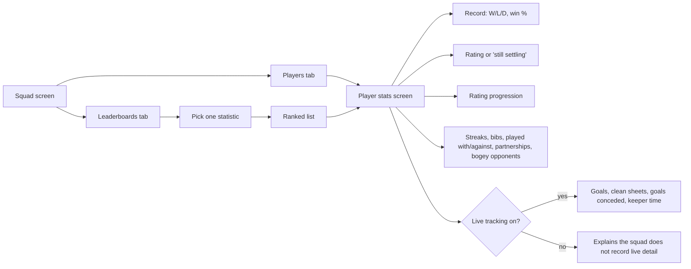
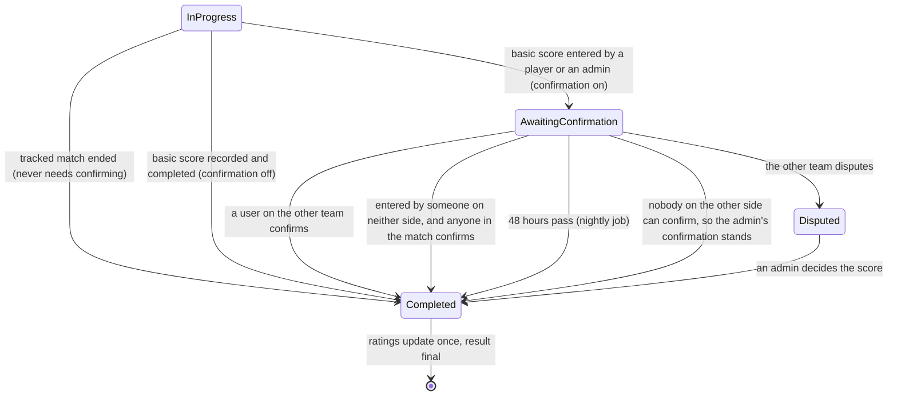

# 03 · Journeys

## Purpose

How a person moves through PitchMate, end to end, as the web app and API behave today: signing up and joining a squad, taking a match from draft to result, tracking a match live, and looking at stats. Read this before designing a screen or a flow, so the new piece joins an existing path rather than inventing one.

Web paths below are routes in `apps/web/src/app/appRouter.tsx`; everything under `/app` sits behind the sign-in guard (`apps/web/src/features/app-shell/RouteGuard.tsx`).

## Today (as-is)

### Journey 1 · Sign up and join a squad

| Step | Status | Detail | Source |
|---|---|---|---|
| Landing page with sign-up and log-in calls to action | **Built** | Hero, benefits, how it works, stats showcase, footer | `apps/web/src/features/landing/LandingPage.tsx`, `apps/web/src/features/landing/content/landingContent.ts` |
| Register with email and password | **Built** | 12–128 character password; a verification email is started; no session is created by sign-up itself | `apps/web/src/features/auth/SignUpScreen.tsx`, `backend/src/PitchMate.Application/Auth/UseCases/RegisterWithPasswordHandler.cs`, `backend/src/PitchMate.Domain/Auth/PasswordPolicy.cs` |
| Verify email | **Built** | Link redeemed at `/verify-email`; resend when signed in. Verification is **not required** to sign in by default | `apps/web/src/features/auth/VerifyEmailScreen.tsx`, `backend/src/PitchMate.Application/Auth/UseCases/SignInProtectionOptions.cs` |
| Log in with password | **Built** | Returns a 15-minute access token and a rotating refresh token; the web refreshes just in time | `apps/web/src/features/auth/LogInScreen.tsx`, `apps/web/src/features/auth/session/SessionManager.ts` |
| Log in with Google | **Partial** | The API verifies Google ID tokens, but the web button is wired to a stub that returns nothing, and the client id is a placeholder in both environments | `backend/src/PitchMate.Infrastructure/Auth/GoogleProviderVerifier.cs`, `apps/web/src/app/appRouter.tsx:225`, `apps/web/src/features/auth/components/GoogleSignInControl.tsx` |
| Forgot and reset password | **Built** | Request always answers the same way; the emailed code is redeemed at `/reset-password/confirm` and signs out every session | `apps/web/src/features/auth/ResetRequestScreen.tsx`, `apps/web/src/features/auth/ResetConfirmScreen.tsx`, `backend/src/PitchMate.Application/Auth/PasswordReset/RedeemPasswordResetHandler.cs` |
| Invite link shows nothing about the squad before joining | **Built** | The anonymous preview is a static message; the landing heading names no squad | `backend/src/PitchMate.Api/Squads/Endpoints/SquadEndpoints.cs:391`, `apps/web/src/features/squads/screens/InviteLandingScreen.tsx` |
| Sign-up → auto-join | **Partial** | The return target (`?redirect=`) is held in memory, so it survives sign-up → log-in in the same tab but is lost on a reload or when the verification email is opened in a new tab; the person then has to open the invite link again | `apps/web/src/features/auth/session/redirectTargetStore.ts`, `apps/web/src/features/auth/session/authNavigation.ts` |
| Redeem the invite | **Built** | Creates the membership, or reactivates the old one; a display-name clash asks for another name | `backend/src/PitchMate.Application/Squads/UseCases/RedeemInviteHandler.cs`, `apps/web/src/features/squads/screens/InviteLandingScreen.tsx` |
| Create a squad from the squads home | **Built** | Squad name plus your display name; the creator is the owner | `apps/web/src/features/squads/screens/SquadsHome.tsx`, `backend/src/PitchMate.Application/Squads/UseCases/CreateSquadHandler.cs` |
| Claim a guest profile via `/claim/:code` | **Built** | Sign in, see the guest and squad name, accept; an admin then completes it | `apps/web/src/features/squads/screens/ClaimLandingScreen.tsx`, `backend/src/PitchMate.Application/Squads/UseCases/AcceptGuestClaimHandler.cs` |
| Privacy policy and terms linked from sign-up and the footer | **Gap** | The links point at `/privacy` and `/terms`, which have no route and fall to the not-found page | `apps/web/src/features/auth/SignUpScreen.tsx:75`, `apps/web/src/features/landing/content/landingContent.ts:283` |

### Journey 2 · The match lifecycle

Rolling, re-rolling, moving players, naming teams and choosing bibs all happen **inside `Confirmed`**; the state only becomes `TeamsRolled` at the lock.

| Step | Status | Detail | Source |
|---|---|---|---|
| 1. Create a match draft | **Built** | Location (1–200 characters) and 1–14 distinct future candidate days; the web allows up to two kick-off times per day. Members are notified | `backend/src/PitchMate.Domain/Matches/Match.cs:168`, `apps/web/src/features/matches/screens/CreateMatchScreen.tsx`, `apps/web/src/features/matches/lib/candidateSlots.ts` |
| 2. Members mark the days they can make | **Built** | Changeable until confirmation; guests excluded from self-service | `backend/src/PitchMate.Application/Matches/UseCases/SubmitAvailabilityResponseHandler.cs:119`, `apps/web/src/features/matches/screens/MatchScreen.tsx` |
| 2. An admin marks days for each guest | **Built** | Organiser-only, target must be an active guest | `backend/src/PitchMate.Application/Matches/UseCases/SetGuestAvailabilityHandler.cs:78` |
| 3. Confirm on any candidate day, seeing the tally | **Built** | No minimum number of players; everyone marked for that day, guests included, becomes a player | `backend/src/PitchMate.Domain/Matches/Match.cs:397`, `backend/src/PitchMate.Api/Matches/Endpoints/MatchEndpoints.cs:289` |
| 4. Members join or leave; an admin adds or removes anyone | **Built** | Allowed only in `Confirmed`, i.e. until teams are locked | `backend/src/PitchMate.Application/Matches/UseCases/JoinMatchHandler.cs:61`, `backend/src/PitchMate.Domain/Matches/Match.cs:466` |
| 4. Roll teams | **Built** | Needs 10–16 players, always two teams; the proposal carries each side's win % and the draw % | `backend/src/PitchMate.Application/Matches/UseCases/ProposeTeamsHandler.cs:38`, `apps/web/src/features/matches/components/TeamsEditor.tsx` |
| 4. Tweak: move a player, re-roll, set team names or roll a silly name, choose the bib team | **Built** | The first roll gives generated names and bibs to the first team | `backend/src/PitchMate.Application/Matches/UseCases/AdjustTeamsHandler.cs:109`, `apps/web/src/features/matches/components/TeamsEditor.tsx` |
| 4. Lock | **Built** | Requires at least two teams, 5–8 players a side, everyone on a team, exactly one bib team, distinct team names. Captures the kickoff lineup and notifies members | `backend/src/PitchMate.Domain/Matches/Match.cs:770`, `backend/src/PitchMate.Application/Matches/UseCases/LockTeamsHandler.cs:119` |
| 4. Unlock before kickoff | **Built** | Back to `Confirmed` with teams, names and bibs kept and the lineup discarded | `backend/src/PitchMate.Domain/Matches/Match.cs:854` |
| Team sheet | **Built** | Time, location, both teams with names and players, bib flag; shown once teams are locked | `backend/src/PitchMate.Application/Matches/UseCases/GetTeamSheetHandler.cs:81`, `apps/web/src/features/matches/components/TeamSheetView.tsx` |
| 5. Start the match | **Built** | Stamps the kickoff instant | `backend/src/PitchMate.Domain/Matches/Match.cs:911` |
| 5. Undo kickoff | **Built** | Refused once a result or any live event exists; clears the kickoff instant | `backend/src/PitchMate.Domain/Matches/Match.cs:935`, `apps/web/src/features/matches/components/MatchActionsPanel.tsx` |
| 5. Record a basic result, then complete | **Built** | Scores 0–99 per team; the web offers this only when live tracking is off. A result can be overwritten until completion | `backend/src/PitchMate.Domain/Matches/Match.cs:991`, `apps/web/src/features/matches/screens/MatchScreen.tsx` |
| 5. Completing updates ratings once | **Built** | One rating update from the kickoff lineup, one snapshot per player, atomic and idempotent; members are notified | `backend/src/PitchMate.Application/Matches/UseCases/CompleteMatchHandler.cs:171` |
| Cancel | **Built** | From `GatheringAvailability`, `Confirmed` or `TeamsRolled`; no notification is sent | `backend/src/PitchMate.Domain/Matches/Match.cs:1225`, `backend/src/PitchMate.Application/Matches/UseCases/CancelMatchHandler.cs:97` |
| Correct a result after completion | **Gap** | A completed match is immutable and there is no correction use case | `backend/src/PitchMate.Domain/Matches/Match.cs:1188` |
| Edit a draft (location, days) after creating it | **Gap** | No use case; the only way is cancel and recreate | `backend/src/PitchMate.Api/Matches/Endpoints/MatchEndpoints.cs` |

### Journey 3 · Live tracking

Only in a squad with **live match tracking** switched on, and only an admin records.

| Step | Status | Detail | Source |
|---|---|---|---|
| Record a goal: GOAL → team → scorer, with skip and own goal | **Built** | The scorer must be in the lineup and on the scoring team unless it is an own goal | `apps/web/src/features/matches/components/GoalPicker.tsx`, `backend/src/PitchMate.Domain/LiveTracking/MatchEventValidation.cs` |
| Keeper changes | **Built** | Recorded as stints; goals conceded are attributed to the keeper in goal at that minute | `apps/web/src/features/matches/screens/LiveTrackerScreen.tsx`, `backend/src/PitchMate.Domain/LiveTracking/MatchEventLog.cs` |
| Undo the last goal | **Built** | A button plus a 10-second toast | `apps/web/src/features/matches/screens/LiveTrackerScreen.tsx:303` |
| Change a scorer, remove any goal, remove a keeper change | **Built** | From the timeline; implemented as retractions appended to the log | `apps/web/src/features/matches/screens/LiveTrackerScreen.tsx:323`, `apps/web/src/features/matches/lib/messages.ts:542` |
| Minutes count from the kickoff instant | **Built** | The kickoff instant is stored at start; the minute is computed by the client and sent with the event | `backend/src/PitchMate.Domain/Matches/Match.cs:911`, `backend/src/PitchMate.Application/LiveTracking/UseCases/RecordEventBatchHandler.cs` |
| Members see the live score | **Built** | The match page polls the running score every 20 seconds; there is no push channel | `apps/web/src/features/matches/components/LiveScorePanel.tsx:30` |
| End the match from the tracker | **Built** | The tracked score becomes a rich result and the match completes in one step | `backend/src/PitchMate.Application/LiveTracking/UseCases/FinaliseTrackedResultHandler.cs:121` |
| Reload keeps the keeper and the goals | **Built** | The tracker starts from the server's event log | `apps/web/src/features/matches/state/useEventLog.ts` |
| Tracking without a connection | **Partial** | A failed send is kept and resent only while the page stays open; the queue is not persisted, so a reload loses unsent events. The API is ready for offline clients (idempotent client ids, batches, per-event outcomes) | `apps/web/src/features/matches/state/useEventLog.ts`, `backend/src/PitchMate.Domain/LiveTracking/EventIdPolicy.cs`, `backend/src/PitchMate.Application/LiveTracking/UseCases/RecordEventBatchHandler.cs:123` |
| Assists, cards, substitutions, per-player time on pitch | **Gap** | The event kinds are goals and keeper stints only | `backend/src/PitchMate.Domain/LiveTracking/EventKind.cs` |

### Journey 4 · Stats

| Step | Status | Detail | Source |
|---|---|---|---|
| Leaderboards, one statistic at a time | **Built** | Appearances, win %, display rating (default), win streak, unbeaten streak, bib appearances | `apps/web/src/features/player-stats/screens/SquadLeaderboards.tsx`, `backend/src/PitchMate.Application/Stats/LeaderboardStatistic.cs` |
| Player stats screen for any member or guest, scoped to the squad it was opened from | **Built** | `/app/squads/:squadId/players/:membershipId` | `apps/web/src/features/player-stats/screens/PlayerStatsScreen.tsx`, `backend/src/PitchMate.Application/Stats/GetPlayerProfileHandler.cs:93` |
| Provisional players show no number | **Built** | "Rating still settling" and a "~ Provisional" band on the chart | `apps/web/src/features/player-stats/components/RatingPanel.tsx`, `apps/web/src/features/player-stats/components/ProgressionChart.tsx` |
| Rich stats degrade gracefully | **Built** | Disabled or empty states rather than zeros | `apps/web/src/features/player-stats/lib/richStats.ts` |
| Top scorer and other rich-stat leaderboards | **Partial** | Goals show on a profile; a top-scorer query exists in the stats port but nothing calls it and no leaderboard offers it | `backend/src/PitchMate.Application/Stats/IRichStatsSource.cs`, `backend/src/PitchMate.Application/Stats/LeaderboardStatistic.cs` |
| A user's cross-squad vanity aggregate | **Gap** | Nothing in the code | `backend/src/PitchMate.Application/Stats` |
| A profile page for the signed-in user | **Gap** | `/app/profile` shows "not ready yet" | `apps/web/src/features/app-shell/shellRoutes.tsx:316` |

## To be

What is wanted, from [decisions](decisions.md). Nothing in this section is built unless the line says so; the journeys above are what happens today. Ids refer to [05 · Features](05-features.md#to-be), [04 · Devices](04-devices.md#to-be) and [07 · Trust](07-trust.md#to-be).

### Journey 1 · Sign up and join a squad

| Change | Status | Decision |
|---|---|---|
| Sign-up is followed by **email verification before the first sign-in** (SE-15) | **Gap** | [Q9](decisions.md#q9) |
| The **invite survives verification**: a person who signs up from an invite link, verifies in another tab and signs in still lands in the squad without opening the link again (SQ-07) | **Gap** | [Q9](decisions.md#q9) |
| Verification, reset and notification **emails are really sent** (NO-03) | **Gap** | [Q9](decisions.md#q9) |
| **Google sign-in works on the web**, and the iOS app adds **Sign in with Apple** (AC-04, AC-05) | **Gap** | [A1](decisions.md#a1) |
| The same journey exists **in the Android and iOS apps**, which the launch waits for (DV-01, DV-02) | **Gap** | [R3](decisions.md#r3) |
| The **privacy policy and terms** linked from sign-up exist (WE-05) | **Gap** | [Q8](decisions.md#q8) |
| Repeated failed sign-ins **lock the account for 15 minutes after 5 attempts** (AC-13) | **Gap** | [Q9](decisions.md#q9) |

### Journey 2 · The match lifecycle

| Change | Status | Decision |
|---|---|---|
| **Teams can be rolled and locked from 3 to 11 a side**, the sides at most 2 apart; the 10–16 and 5–8-a-side limits go (TB-09, TB-11) | **Gap** | [Q12](decisions.md#q12), [R7](decisions.md#r7), [T7](decisions.md#t7) |
| **Once Pro is on sale, a free squad's roll is a random split**, which the admin then swaps, with no win % shown; one match a month gets balanced rolls. In a Pro squad every roll is balanced. Until Pro is on sale every squad's rolls are balanced (TB-13, TB-14) | **Gap** | [T1](decisions.md#t1), [U3](decisions.md#u3), [U4](decisions.md#u4) |
| The balancer always obeys the squad's standing **keep-together and keep-apart rules**, which only admins see (TB-10) | **Gap** | [Q13](decisions.md#q13), [R8](decisions.md#r8) |
| The lock sends **"Teams locked" with the team sheet**; the roll sends nothing (NO-07) | **Gap** | [R2](decisions.md#r2) |
| The admin can **pick a tracker** for the match, who can then start it, undo kickoff and record a basic score (RE-09) | **Gap** | [R1](decisions.md#r1), [T6](decisions.md#t6) |
| In a Pro squad the admin can **shape the match-day flow** with two options: availability on or off, and payment tracking (MA-11). Score confirmation and team naming are not among them; they are free | **Gap** | [R5](decisions.md#r5), [T4](decisions.md#t4), [U2](decisions.md#u2) |
| **Cancelling a match notifies members** (NO-06) | **Gap** | [Q16](decisions.md#q16) |
| **A completed result is never corrected** (RE-07 is decided against). This is already how the code behaves: a completed match is immutable (`backend/src/PitchMate.Domain/Matches/Match.cs:1188`) | **Built** | [Q11](decisions.md#q11) |
| In any squad that turns **score confirmation** on (it is free), any player in the match or an admin enters a basic score and a user on the other team confirms it before the match completes; if the person entering it played on neither side, anyone in the match confirms. Unconfirmed after 48 hours, it confirms itself; a dispute goes to an admin. A live-tracked result needs no confirmation. Ratings update on confirmation (RE-08) | **Gap** | [Q11](decisions.md#q11), [R6](decisions.md#r6), [T5](decisions.md#t5), [U2](decisions.md#u2) |

The proposed end of the lifecycle with score confirmation on. The extra step and its name are a sketch for the feature spec, not a decided state machine:

### Journey 3 · Live tracking

| Change | Status | Decision |
|---|---|---|
| The **phone app** is the first new tracker to be built, and it **keeps working offline** with an outbox that survives a restart (DV-03). The web tracker keeps needing a connection | **Gap** | [Q5](decisions.md#q5), [U5](decisions.md#u5) |
| The **Apple Watch app** is the main way to track, and is there at launch; Wear OS follows (DV-04, DV-09) | **Gap** | [Q5](decisions.md#q5), [T10](decisions.md#t10) |
| Members keep seeing the **live score by polling** every 20 seconds (`apps/web/src/features/matches/components/LiveScorePanel.tsx:30`) | **Built** | [Q6](decisions.md#q6) |
| The match's **tracker**, not only an admin, starts the match and runs the tracker (RE-09) | **Gap** | [R1](decisions.md#r1) |
| **Keeper changes leave the tracker, and keeper data is removed**: GOAL → team → scorer, own goals and corrections remain (RE-10) | **Gap** | [R13](decisions.md#r13), [T9](decisions.md#t9) |
| **Live tracking is free.** It stays behind the squad's own toggle, with no Pro entitlement. This is how the code behaves today (`backend/src/PitchMate.Domain/Squads/SquadFeature.cs`) | **Built** | [T2](decisions.md#t2) |

### Journey 4 · Stats

| Change | Status | Decision |
|---|---|---|
| **Every available stat is shown**, including a top-scorer leaderboard (ST-08, ST-11) | **Gap** | [Q18](decisions.md#q18) |
| **Keeper-only stats are removed**, data included: clean sheets, goals conceded as keeper, keeper time (RE-10) | **Gap** | [R13](decisions.md#r13), [T9](decisions.md#t9) |
| **Every player shows a rating number from their first match**, with a "settling" note while it is still uncertain; the progression chart plots numbers throughout (RA-13, ST-12) | **Gap** | [T8](decisions.md#t8), [U1](decisions.md#u1) |
| The signed-in user's "profile" destination becomes the **account screen** (WE-04) | **Gap** | [Q17](decisions.md#q17) |

## Rules

- **Built** · A signed-out visitor to any `/app` path is sent to `/login?redirect=…` and returned afterwards; the return target must be a same-origin, non-auth path. `apps/web/src/features/app-shell/RouteGuard.tsx`, `apps/web/src/features/auth/lib/redirectTarget.ts`
- **Built** · Match states and transitions are enforced in the domain entity; no handler sets a state directly. `backend/src/PitchMate.Domain/Matches/Match.cs`
- **Built** · The lineup is editable until kickoff (unlock) and immutable once play starts; ratings use the kickoff lineup only. `backend/src/PitchMate.Domain/Matches/Match.cs:854`, `backend/src/PitchMate.Application/Matches/UseCases/CompleteMatchHandler.cs`
- **Built** · Both result fidelities end in the same completion step, so ratings always update. `backend/src/PitchMate.Application/LiveTracking/UseCases/FinaliseTrackedResultHandler.cs`, `backend/src/PitchMate.Application/Matches/UseCases/CompleteMatchHandler.cs`
- **Built** · The live event log is append-only; a correction is a retraction, never an edit or delete. `backend/src/PitchMate.Domain/LiveTracking/MatchEventLog.cs`
- **Built** · Match creation and live events are idempotent on a client-supplied id. `backend/src/PitchMate.Application/Matches/UseCases/CreateMatchDraftHandler.cs`, `backend/src/PitchMate.Domain/LiveTracking/EventIdPolicy.cs`

## Open questions

None waiting on the user. Round four settled that score confirmation and team naming are free ([U2](decisions.md#u2)) and that the web tracker needs a connection ([U5](decisions.md#u5)). Left for the feature specs:

1. **With confirmation off, should recording a basic result complete the match in one action**, as ending a tracked match does? Today it is two steps.
2. **`product.md` understates the tracker's corrections.** It says corrections "go no further than undoing the last goal", but the tracker can change a scorer and remove any goal (`apps/web/src/features/matches/screens/LiveTrackerScreen.tsx:323`). A reworded Today note is proposed in [decisions](decisions.md#proposed-productmd-changes).
3. **A member can only join or leave while the match is `Confirmed`.** After the lock they need an admin to unlock. Intended?
4. **Availability off** (MA-11): a match with no availability step has to start somewhere. The likely shape is "pick a day, and members join", which is today's Confirmed state without the candidate days.
5. **Does a claim link survive verification too**, as the invite must?

## Ideas

- **Idea** · Remember a pending invite or claim code in storage so it survives email verification and a new tab.
- **Idea** · A "who's in" share card for the group chat once a match is confirmed.
- **Idea** · Reminders: "you haven't marked your days" and "match tomorrow".
- **Idea** · A waiting list when a match is full at 16.
- **Idea** · Recurring matches (same place, same weekday) so the admin doesn't recreate the draft each week.
- **Idea** · Assists and a man-of-the-match vote as new event kinds or post-match inputs.
- **Idea** · Presets for the **match-day options** (MA-11): a short flow of pick a day, invite players, record the result; a long one adding availability and payment tracking.
