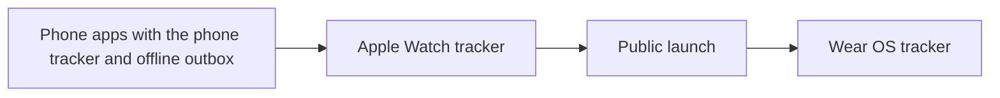

# 04 · Devices

## Purpose

Which devices PitchMate runs on and what each client can do. The honest summary: **the web app is the only client that exists.** `apps/mobile` and `apps/watch` each contain one README and no code. This chapter says what the web does on each screen size, and what the backend already provides for the clients that are not built.

## Today (as-is)

| Device | Client | Status | Source |
|---|---|---|---|
| Desktop and laptop browser | React web app | **Built** | `apps/web/package.json`, `apps/web/src/app/appRouter.tsx` |
| Phone browser | The same web app, responsive | **Built** | `apps/web/src/features/app-shell/state/useViewportLayout.ts` |
| Android app | None | **Gap** | `apps/mobile/README.md` |
| iOS app | None | **Gap** | `apps/mobile/README.md` |
| Watch (watchOS) | None | **Gap** | `apps/watch/README.md` |

### Web

| Line | Status | Source |
|---|---|---|
| A single-page app (React 19, Vite, React Router) served as static files from Azure Static Web Apps, calling the API cross-origin | **Built** | `apps/web/package.json`, `apps/web/public/staticwebapp.config.json`, `infra/main.bicep:337` |
| Every feature in [05 · Features](05-features.md) that has a UI has it here | **Built** | `apps/web/src/features` |
| Responsive layout: the shell switches at 768px, and the landing page, match screens, team sheet and cards have their own narrow-screen rules | **Built** | `apps/web/src/features/app-shell/state/useViewportLayout.ts`, `apps/web/src/ui/TeamSheet.css`, `apps/web/src/ui/Steps.css` |
| Dark-first theme with a System / Dark / Light choice, applied before first paint and remembered on the device | **Built** | `apps/web/src/theme/themeBootstrap.ts`, `apps/web/src/theme/appearancePreference.ts`, `apps/web/src/features/app-shell/SettingsDestination.tsx` |
| The session survives a reload (stored in `localStorage`) | **Built** | `apps/web/src/features/auth/session/SessionStore.ts` |
| Installable app (web manifest, home-screen icon) | **Gap** | `apps/web/index.html` |
| Offline use (service worker, cached shell, persisted outbox) | **Gap** | `apps/web/src/features/matches/state/useEventLog.ts` |
| Push notifications | **Gap** | `backend/src/PitchMate.Domain/Notifications/DeliveryChannel.cs` |
| Updates arrive by polling: unread notifications every 60 seconds, live score every 20 seconds; nothing is pushed | **Partial** | `apps/web/src/features/app-shell/lib/pollInterval.ts`, `apps/web/src/features/matches/components/LiveScorePanel.tsx:30` |
| Pitch-side use on a phone: the live tracker works in a phone browser but needs a connection for the whole match | **Partial** | `apps/web/src/features/matches/screens/LiveTrackerScreen.tsx`, `apps/web/src/features/matches/state/useEventLog.ts` |

### Mobile (Android and iOS)

`apps/mobile/README.md` in full intent: React Native + Expo for iOS and Android, **not yet started**; Apple Sign-In is required for iOS; the app will consume the same API through `@pitchmate/api-client`.

| Line | Status | Source |
|---|---|---|
| Any mobile app code | **Gap** | `apps/mobile/README.md` |
| Sign in with Apple: the provider value exists in the domain enum but no verifier, endpoint or UI uses it | **Gap** | `backend/src/PitchMate.Domain/Auth/AuthProvider.cs` |
| Push delivery: the notification model names the channel but only in-app and email are implemented | **Gap** | `backend/src/PitchMate.Domain/Notifications/DeliveryChannel.cs`, `backend/src/PitchMate.Application/Notifications/PublishNotificationHandler.cs` |
| A typed API client any TypeScript client can share | **Built** | `packages/api-client/package.json`, `packages/api-client/src/index.ts` |
| A session model that suits native clients: short access token, rotating refresh token in the request body, no cookies | **Built** | `backend/src/PitchMate.Application/Auth/UseCases/RefreshSessionHandler.cs`, `backend/src/PitchMate.Api/WebClientCors.cs` |
| Mobile screen designs | **Partial** | The brand rule says the design-system artifact holds mobile mockups; none of them is implemented and this pass did not open the artifact | `.claude/rules/brand.md` |

### Watch

`apps/watch/README.md` in full intent: native SwiftUI on watchOS for live match tracking, **not yet started**; the watch syncs through the paired phone and acts as one of several offline-first live-tracking clients.

| Line | Status | Source |
|---|---|---|
| Any watch app code | **Gap** | `apps/watch/README.md` |
| The server side of offline-first tracking: client-generated time-ordered event ids, batched submission, per-event Applied / Duplicate / Rejected outcomes, duplicates harmless | **Built** | `backend/src/PitchMate.Domain/LiveTracking/EventIdPolicy.cs`, `backend/src/PitchMate.Domain/LiveTracking/EventOutcome.cs`, `backend/src/PitchMate.Application/LiveTracking/UseCases/RecordEventBatchHandler.cs` |
| A relay of the phone's session to the watch | **Gap** | `.claude/rules/security-and-privacy.md` |
| Several people tracking the same match at once: the log accepts events from any admin client, but nothing reconciles two clients recording the same goal under different ids | **Partial** | `backend/src/PitchMate.Application/LiveTracking/UseCases/RecordEventBatchHandler.cs` |

## To be

What is wanted, from [decisions](decisions.md). **None of this is built** except the polling line. `apps/mobile` and `apps/watch` are still one README each. The public launch waits for DV-01 to DV-07 and DV-10 ([R3](decisions.md#r3), [T10](decisions.md#t10)); only the Wear OS tracker (DV-09) comes after it.

| Id | Requirement | Status | Decision |
|---|---|---|---|
| DV-01 | **An Android app**, built with React Native + Expo in one TypeScript codebase shared with iOS, using `@pitchmate/api-client` and the design tokens. It covers what a player and an admin do on the web: squads, availability, matches, teams, the team sheet, results, stats, notifications. Nothing an admin can do is web-only (DV-10) | **Gap** | [Q4](decisions.md#q4), [R4](decisions.md#r4), [T11](decisions.md#t11) |
| DV-02 | **An iOS app** from the same codebase, with the same scope | **Gap** | [Q4](decisions.md#q4), [R4](decisions.md#r4) |
| DV-03 | **Live tracking in the phone app, offline-first**: events are queued on the device, survive the app closing, and are sent when a connection returns. The API already accepts this (client event ids, batches, per-event outcomes) | **Gap** | [Q5](decisions.md#q5) |
| DV-04 | **An Apple Watch app in SwiftUI, at launch, as the main way to live-track.** It is built after the phone tracker, whose tracking logic and offline outbox it relies on, and before the launch | **Gap** | [Q5](decisions.md#q5), [R4](decisions.md#r4), [T10](decisions.md#t10) |
| DV-09 | **A Wear OS tracker, after the launch.** It is a second native codebase for fewer users, and an Android user has the phone tracker from day one | **Gap** | [R4](decisions.md#r4), [T10](decisions.md#t10) |
| DV-10 | **Parity.** The web keeps every feature except watch tracking and offline tracking, and the phone app does everything an admin can do. A feature is built for both, apart from what a device cannot do (the watch tracker, offline tracking, push, store purchases). The web tracker needs a connection, as today | **Gap** | [T11](decisions.md#t11), [U5](decisions.md#u5) |
| DV-05 | **Push notifications** from the apps, for the events that are emailed today (NO-05) | **Gap** | [Q4](decisions.md#q4) |
| DV-06 | **Tokens in the device's secure store**: the Keychain on iOS, the Keystore on Android (SE-22) | **Gap** | [Q10](decisions.md#q10) |
| DV-07 | **Sign in with Apple** in the iOS app, required by Apple because Google sign-in is offered (AC-05) | **Gap** | [A1](decisions.md#a1) |
| DV-08 | **The web keeps polling**: 20 seconds for the live score, 60 for unread notifications (`apps/web/src/features/app-shell/lib/pollInterval.ts`, `apps/web/src/features/matches/components/LiveScorePanel.tsx:30`) | **Built** | [Q6](decisions.md#q6) |

**Decided against:** an installable, offline-capable web app as the first "mobile" release ([Q4](decisions.md#q4)). The web manifest, service worker and web push lines under Today stay Gap and are not planned.

The order of work that [T10](decisions.md#t10) implies:

## Rules

- **Built** · One API and one generated contract for every client; no client reimplements rating maths. `packages/api-client/package.json`, `backend/src/PitchMate.Domain/Stats/DisplayRatingCalculator.cs`
- **Built** · One session model across clients: bearer access token plus rotating refresh token. `backend/src/PitchMate.Infrastructure/Auth/JwtTokenService.cs`
- **Built** · Dark mode is designed first; every token has a light value too. `apps/web/src/design/tokens.css`
- **Gap** · Apple Sign-In ships with the iOS app (an App Store requirement once Google sign-in is offered). `apps/mobile/README.md`

## Open questions

None waiting on the user. Round four settled that the web tracker stays connection-only ([U5](decisions.md#u5)) and confirmed that Wear OS follows the launch. Left for the feature specs:

1. **How the watch signs in and syncs.** Through the paired phone is the accepted default; it means a tracker needs their phone nearby, or the watch must queue events until it is.
2. **Two devices tracking the same match.** Nothing reconciles two clients recording the same goal under different ids (`backend/src/PitchMate.Application/LiveTracking/UseCases/RecordEventBatchHandler.cs`). There is one tracker at a time ([T6](decisions.md#t6)), but admins can still record, and one person may hold a watch and a phone. Is it one recording device at a time?
3. **How much the watch adds to the launch.** A second language and toolchain, a second store review, and testing on real watches. The size should be known before a launch date is named.

## Ideas

- **Idea** · Ship the web app as an installable PWA with a persisted tracker outbox as the first "mobile" release.
- **Idea** · Web push for match drafted / confirmed / teams set, ahead of any native app.
- **Idea** · A lock-screen or home-screen widget showing the next match and whether you have marked your days.
- **Idea** · A watch companion that only does GOAL → team → scorer, with everything else on the phone.
- **Idea** · A big-screen "team sheet" mode for a tablet or a phone propped at the side of the pitch.
