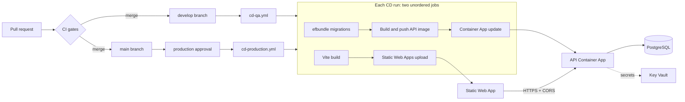

# 06 · Platform

## Purpose

Where PitchMate runs and how a change reaches it: the Azure resources, the two environments, the CI gates, the CD pipelines and how database migrations ship. Read this before touching `infra/`, `.github/workflows/` or a Dockerfile.

## Today (as-is)

### Deployment picture

### Azure resources

All resources are declared in one template, deployed per environment into one resource group.

| Resource | Status | Detail | Source |
|---|---|---|---|
| API on **Azure Container Apps** | **Built** | One container app, 0.5 vCPU / 1 GiB, single-revision mode, external HTTPS-only ingress on port 5243, liveness and readiness probes on `/health` | `infra/main.bicep:272`, `infra/main.bicep:284`, `infra/main.bicep:289`, `infra/main.bicep:323` |
| Container Apps environment | **Built** | Consumption profile, logs to Log Analytics | `infra/main.bicep:251` |
| Scaling | **Built** | Min/max replicas only (default 0–2); no custom scale rules. QA scales to zero, production keeps one replica | `infra/main.bicep:72`, `infra/main.bicep:329`, `infra/main.qa.bicepparam:34`, `infra/main.prod.bicepparam:29` |
| Container Registry | **Built** | Basic tier; the API pulls with a user-assigned managed identity (AcrPull) | `infra/main.bicep:203`, `infra/main.bicep:214` |
| Web on **Azure Static Web Apps** | **Built** | Free tier, in `eastus2` (the API region is the resource group's) | `infra/main.bicep:337`, `infra/main.bicep:31` |
| PostgreSQL Flexible Server | **Partial** | PG 16, `Standard_B1ms`, 7-day backups, no HA, public access with the "all Azure services" firewall rule. Created **only** when `useExternalDatabase` is false, so it does not exist in QA | `infra/main.bicep:119`, `infra/main.bicep:133`, `infra/main.bicep:154`, `infra/main.qa.bicepparam:16` |
| External database (Supabase) for QA | **Built** | QA sets `useExternalDatabase = true`; the operator puts the Supabase session-pooler connection string in Key Vault by hand. The free project pauses after 7 idle days | `infra/main.qa.bicepparam:16`, `infra/README.md:27`, `infra/README.md:38` |
| Key Vault | **Built** | RBAC, 7-day soft delete, no purge protection. Holds `Db-ConnectionString` and `Auth-SigningKey` | `infra/main.bicep:164`, `infra/main.bicep:178`, `infra/main.bicep:187` |
| Secrets into the API | **Built** | Key Vault references resolved by the managed identity, surfaced as `ConnectionStrings__Default` and `Auth__Token__SigningKey` | `infra/main.bicep:297`, `infra/main.bicep:310`, `infra/main.bicep:314` |
| CORS | **Built** | The API allows exactly the Static Web App's default hostname | `infra/main.bicep:320`, `backend/src/PitchMate.Api/WebClientCors.cs` |
| Log Analytics + Application Insights | **Partial** | Both resources exist and the connection string is passed to the API, but no Application Insights or OpenTelemetry SDK is referenced in `backend/src`, so only container logs are collected | `infra/main.bicep:99`, `infra/main.bicep:108`, `infra/main.bicep:309` |
| Custom domain `pitch-mate.co.uk`, DNS, managed certificates | **Gap** | Nothing in the template; both endpoints use platform default hostnames. The domain is named only in `README.md:3` | `infra/main.bicep` |
| Private networking | **Gap** | No VNet or private endpoints; Key Vault, registry and the owned Postgres are publicly reachable (identity- and firewall-protected) | `infra/main.bicep:154` |
| Alerts, availability tests, action groups | **Gap** | None declared | `infra/main.bicep` |
| Email transport in the cloud | **Gap** | Email stays on the Console transport (messages go to the API log) | `infra/README.md:55` |
| Google sign-in client id | **Gap** | A placeholder in both parameter files | `infra/main.qa.bicepparam`, `infra/main.prod.bicepparam` |

### Environments

| Line | Status | Source |
|---|---|---|
| Two environments are modelled: `qa` and `prod` (`environmentName`), each with a parameter file | **Built** | `infra/main.bicep:24`, `infra/main.qa.bicepparam`, `infra/main.prod.bicepparam` |
| The API runs as `Staging` in QA and `Production` in prod | **Built** | `infra/main.bicep:308` |
| QA is provisioned by a manual script: two-pass Bicep deploy (infra, then API once an image exists), image build and push, then `dotnet ef database update` | **Built** | `infra/deploy-qa.ps1` |
| GitHub→Azure auth is OIDC (no stored cloud credentials); `configure-qa.ps1` creates the Entra app, the federated credentials, the `qa` and `production` GitHub environments, and the QA secrets and variables | **Built** | `infra/configure-qa.ps1`, `.github/workflows/cd-qa.yml:64` |
| `verify-qa.ps1` checks deployment state, API revisions, `/health` and the web status code | **Built** | `infra/verify-qa.ps1` |
| Production has a parameter file but no deploy script, and the OIDC identity is granted roles on the QA resource group and registry only | **Partial** | `infra/main.prod.bicepparam`, `infra/configure-qa.ps1` |
| Infrastructure changes are applied only by the manual script; no workflow runs a Bicep deployment | **Gap** | `.github/workflows/cd-qa.yml`, `infra/deploy-qa.ps1` |

### CI

| Line | Status | Source |
|---|---|---|
| Backend CI runs on PRs and pushes to `main`/`develop` that touch `backend/**` or `Directory.Build.props` | **Built** | `.github/workflows/ci-backend.yml:9` |
| Backend gates, in order: tool restore → restore → Release build (warnings are errors; emits the OpenAPI document) → OpenAPI drift check → tests (Testcontainers on the runner's Docker) | **Built** | `.github/workflows/ci-backend.yml:54`, `.github/workflows/ci-backend.yml:64`, `.github/workflows/ci-backend.yml:73`, `.github/workflows/ci-backend.yml:79` |
| Web CI runs on PRs and pushes that touch `apps/web/**`, `packages/**` or the root package files | **Built** | `.github/workflows/ci-web.yml:8` |
| Web gates, in order: `npm ci` → TS client drift check → lint → build (tsc + Vite) → Vitest | **Built** | `.github/workflows/ci-web.yml:46`, `.github/workflows/ci-web.yml:65`, `.github/workflows/ci-web.yml:70`, `.github/workflows/ci-web.yml:73`, `.github/workflows/ci-web.yml:80` |
| The same nine gates run locally through `/verify` | **Built** | `.claude/skills/verify/verify.sh:45` |
| A packages-only PR skips the backend OpenAPI gate (path filters), and there is no always-run "changes" job, so path-skipped required checks can block a PR | **Partial** | `.github/workflows/ci-web.yml:61`, `.github/workflows/README.md:22` |
| No C# format or analyser-only lint step, and no image or dependency scanning | **Gap** | `.github/workflows/ci-backend.yml` |

### CD

| Line | Status | Source |
|---|---|---|
| A push to `develop` deploys QA; a push to `main` deploys production. Both can be run by hand | **Built** | `.github/workflows/cd-qa.yml:12`, `.github/workflows/cd-production.yml:16` |
| Every deploy job is skipped unless the repo variable `AZURE_DEPLOY_ENABLED` is `true` | **Built** | `.github/workflows/cd-qa.yml:28`, `.github/workflows/cd-production.yml:31` |
| Production jobs target the `production` GitHub environment, whose required reviewers are the manual approval | **Built** | `.github/workflows/cd-production.yml:33` |
| Backend job: build the migration bundle → OIDC login → open the Postgres firewall to the runner (no-op for an external database) → apply migrations → close the firewall → build and push the image → `az containerapp update` | **Built** | `.github/workflows/cd-qa.yml:54`, `.github/workflows/cd-qa.yml:74`, `.github/workflows/cd-qa.yml:90`, `.github/workflows/cd-qa.yml:107` |
| Web job: build with `VITE_API_BASE_URL` from a repo variable (fails if unset) → upload `apps/web/dist` to Static Web Apps | **Built** | `.github/workflows/cd-qa.yml:149`, `.github/workflows/cd-qa.yml:161` |
| The backend and web jobs have no `needs:` between them, so the web can ship before the API and its migrations | **Partial** | `.github/workflows/cd-qa.yml:127` |
| No post-deploy smoke test, no automatic rollback, no revision traffic splitting | **Gap** | `.github/workflows/cd-qa.yml`, `infra/main.bicep:284` |

### Migrations

| Line | Status | Source |
|---|---|---|
| Migrations never run at application start; a test bans `Migrate`/`EnsureCreated` | **Built** | `.claude/skills/db-migration/SKILL.md:36` |
| In CD, a self-contained `efbundle` is built and applied **before** the new image rolls out, in the same job | **Built** | `.github/workflows/cd-qa.yml:54`, `.github/workflows/cd-qa.yml:90` |
| Packages are restored before the bundle is built (the bundle reads project metadata first) | **Built** | `.github/workflows/cd-qa.yml:48` |
| The manual QA script applies migrations with `dotnet ef database update` rather than the bundle | **Built** | `infra/deploy-qa.ps1` |
| Locally: scaffold, review Up/Down, apply forward–back–forward against the compose database, run the migration tests (`/db-migration`) | **Built** | `.claude/skills/db-migration/SKILL.md` |

### Containers and local development

| Line | Status | Source |
|---|---|---|
| `backend/Dockerfile` publishes the API on `aspnet:10.0`, port 5243, as a non-root user; it is the image CD ships | **Built** | `backend/Dockerfile` |
| `apps/web/Dockerfile` builds the web and serves it from nginx, which proxies API paths to the backend. It is used only by docker-compose and the Makefile; the cloud ships the web through Static Web Apps | **Built** | `apps/web/Dockerfile`, `apps/web/nginx.conf`, `docker-compose.yml:39` |
| `docker compose up` runs PostgreSQL 16, the API and the nginx client | **Built** | `docker-compose.yml:3`, `docker-compose.yml:21`, `docker-compose.yml:39` |
| The Static Web App serves an SPA fallback and security headers (minimal CSP, nosniff, HSTS) | **Built** | `apps/web/public/staticwebapp.config.json:2`, `apps/web/public/staticwebapp.config.json:7` |
| The web Dockerfile builds on Node 22 while CI and CD use Node 24 | **Partial** | `apps/web/Dockerfile`, `.github/workflows/ci-web.yml:41` |

## To be

What is wanted, from [decisions](decisions.md). Nothing in this section is built unless the line says so; the tables above are what the template and workflows declare today.

| Id | Requirement | Status | Launch | Decision |
|---|---|---|---|---|
| PL-01 | **One scheduled job beside the API: an Azure Functions timer, run nightly**, that does not depend on the API being awake (the API scales to zero). It runs the squad purge, the erasure work, score auto-confirm (RE-08), expired-token clean-up (TR-13) and σ decay (RA-06) | **Gap** | Yes | [Q7](decisions.md#q7), [R15](decisions.md#r15) |
| PL-02 | **Production is provisioned**, with its own Postgres Flexible Server on a burstable tier and 7-day point-in-time restore. The template already declares this server when `useExternalDatabase` is false (`infra/main.bicep:119`, `infra/main.bicep:133`); what is missing is the deployment, the production identity's roles, and the production secrets and variables | **Gap** | Yes | [Q19](decisions.md#q19) |
| PL-03 | **Custom domains**: the app at `pitch-mate.co.uk` and, for QA, at `qa.pitch-mate.co.uk`, with DNS and certificates, and CORS and the token issuer following the new hostnames | **Gap** | Yes | [Q20](decisions.md#q20), [R16](decisions.md#r16) |
| PL-04 | **Infrastructure deploys through CD**: a what-if preview of the Bicep change, then a manual approval, then the deployment. The workstation script stops being the only way | **Gap** | | [Q20](decisions.md#q20) |
| PL-05 | **Production deploys are off until production exists, then on behind the approval.** QA and production get separate switches; today the single `AZURE_DEPLOY_ENABLED` variable arms both (`.github/workflows/cd-qa.yml:28`, `.github/workflows/cd-production.yml:31`) | **Gap** | Yes | [Q21](decisions.md#q21) |
| PL-06 | **The docs match the platform**: `CLAUDE.md`, `README.md`, the workflow README and the device READMEs describe Container Apps, the external QA database and a live CD, and no longer mention `.kiro` or `docs/` | **Gap** | | [Q22](decisions.md#q22) |
| PL-07 | **Azure Communication Services email** in the template and configured for QA and production, with a verified sender domain. The ACS sender is implemented in the API; the cloud is on the Console transport (`infra/README.md:55`) | **Gap** | Yes | [Q9](decisions.md#q9) |
| PL-08 | **Somewhere to keep avatars**, for the account screen (AC-10). Nothing stores files today | **Gap** | | [Q17](decisions.md#q17) |
| PL-09 | **The API at `api.pitch-mate.co.uk`, and at `api.qa.pitch-mate.co.uk` for QA**, on the same site as the web so the refresh-token cookie can be SameSite (SE-18 in [07](07-trust.md#to-be)). QA and production share that site too, so each cookie is scoped to its own API host, never to the whole domain | **Gap** | Yes | [Q10](decisions.md#q10), [R16](decisions.md#r16) |
| PL-10 | **Geo-redundant database backup** once there are paying users | **Idea** | | [Q19](decisions.md#q19) |
| PL-11 | **Logs are kept for 90 days.** The template sets 30 (`infra/main.bicep:104`) | **Gap** | Yes | [R11](decisions.md#r11) |
| PL-12 | **QA stays on the external database while the user is the only tester**, which is how it is set today (`infra/main.qa.bicepparam:16`). The setting is switched before anyone else tests on QA | **Built** | | [R17](decisions.md#r17) |
| PL-13 | **App distribution**: store accounts, signing, and a build and release pipeline for the Expo apps, since the launch waits for them. None exists | **Gap** | Yes | [R3](decisions.md#r3), [R4](decisions.md#r4) |
| PL-14 | **Push delivery** for the apps: the platform credentials and a sender the API or the job can call (NO-05) | **Gap** | Yes | [R3](decisions.md#r3) |

## Rules

- **Built** · The contract flows one way, C# API → OpenAPI → TypeScript client, and CI fails on drift in either generated file. `.github/workflows/ci-backend.yml:73`, `.github/workflows/ci-web.yml:65`
- **Built** · Migrations are an explicit, out-of-process deployment step that completes before rollout. `.github/workflows/cd-qa.yml:90`
- **Built** · No cloud credential is stored in GitHub; deployments authenticate by OIDC, and the API reads secrets from Key Vault through its managed identity. `.github/workflows/cd-qa.yml:64`, `infra/main.bicep:297`
- **Built** · Production deploys only from `main`, behind a human approval. `.github/workflows/cd-production.yml:16`, `.github/workflows/cd-production.yml:33`
- **Built** · Ingress is HTTPS-only and the API accepts browser calls from the web origin alone. `infra/main.bicep:289`, `infra/main.bicep:320`

## Open questions

Answered in round two: what the job runs on and how often ([R15](decisions.md#r15)), the hostnames ([R16](decisions.md#r16)), QA's database ([R17](decisions.md#r17)). Still open:

1. **A production deploy was waiting for approval** when the as-is spec was written (seen with `gh` on 2026-11-11; live repository state, not in the repo), and `AZURE_DEPLOY_ENABLED` was `true` for both environments. Under [Q21](decisions.md#q21) that run should be rejected, not approved, and production disarmed until PL-02 is done. This is an action for the user in GitHub, not a code change.
2. **How does the Functions job reach the use cases** (PL-01)? Run the Application and Infrastructure code itself with its own database access, or call an API endpoint, which wakes the API? The first keeps the API asleep and needs the job to have the database secret.
3. **When QA moves off the pausing database** (PL-12), does it get its own Flexible Server, and who triggers the switch?
4. **Who holds the DNS zone** for `pitch-mate.co.uk`, and is it managed in the template or by hand?
5. **Should the web deploy wait for the API?** The jobs are unordered, so a web build can briefly call an API that has not rolled out.
6. **Observability.** Application Insights is provisioned but unused. Wire the SDK before a public launch, or remove the resource?
7. **Secret rotation.** `DB_CONNECTION_STRING` in GitHub is a one-time copy of the Key Vault secret, and rotating `Auth-SigningKey` signs everyone out. Is a rotation procedure needed before launch?
8. **Payments** (OF-05): which provider, and does it need its own webhook endpoint and secrets?

## Ideas

- **Idea** · A post-deploy smoke test (`/health` plus one authenticated round trip) that fails the run and re-points the previous revision.
- **Idea** · Preview environments per pull request using Static Web Apps previews.
- **Idea** · An always-run "changes" job so path-filtered checks can be required safely.
- **Idea** · Uptime and error-rate alerts to email once Application Insights is wired.
- **Idea** · A keep-alive ping so the free QA database does not pause.
- **Idea** · Payments infrastructure (a provider, webhooks, entitlement sync) when a Pro tier is priced ([Q2](decisions.md#q2)).
