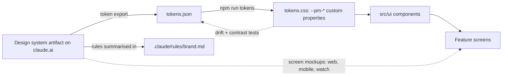

# 08 · Design

## Purpose

How PitchMate looks and sounds, and where that is defined: the brand rules, the design-system artifact, the committed token export, and the shared component library in `apps/web/src/ui`. Read this before building or restyling any screen. The detailed palette, type and voice rules live in `.claude/rules/brand.md` and are not repeated here; this chapter records how far the code follows them.

## Today (as-is)

### The chain of authority

| Line | Status | Detail | Source |
|---|---|---|---|
| The source of truth is the PitchMate design-system artifact (tokens, components, screen mockups for web, mobile and watch, and a README of rules) | **Built** | Linked from the brand rule. This pass did not open the artifact, so nothing here compares it with the code | `.claude/rules/brand.md` |
| Its token export is committed | **Built** | Colour (both themes), type, spacing, radius, shadow, duration, easing, size and z-index | `apps/web/src/design/tokens.json` |
| Tokens are generated into CSS custom properties prefixed `--pm-` | **Built** | 193 declarations, on `:root, [data-theme='dark']` and `[data-theme='light']`; regenerated with `npm run tokens` | `apps/web/scripts/generate-design-tokens.mjs`, `apps/web/src/design/tokens.css`, `apps/web/package.json:13` |
| The generated CSS cannot drift from the export | **Built** | A test regenerates and compares | `apps/web/src/design/tokens.drift.test.ts` |
| Every documented colour pairing meets its contrast target in both themes | **Built** | | `apps/web/src/design/tokens.contrast.test.ts`, `apps/web/src/design/contrast.ts` |
| Checking the committed export against the live artifact | **Gap** | Manual; nothing automated compares them | `.claude/rules/brand.md` |

### Theme, type and assets

| Line | Status | Detail | Source |
|---|---|---|---|
| Dark mode is the primary target | **Built** | The root colour scheme is dark; a pre-paint script sets `data-theme`, defaulting to dark unless the system prefers light | `apps/web/src/index.css:13`, `apps/web/src/theme/themeBootstrap.ts:37`, `apps/web/vite.config.ts` |
| System / Dark / Light choice, remembered on the device | **Built** | In Settings only | `apps/web/src/theme/appearancePreference.ts`, `apps/web/src/features/app-shell/SettingsDestination.tsx` |
| Barlow (400–700) and Barlow Condensed (600, 700, 800, 800 italic), self-hosted | **Built** | No font is fetched from a third party | `apps/web/src/design/fonts.css`, `apps/web/src/design/fonts` |
| Logo marks in green, ink and white, plus the app icon | **Built** | | `apps/web/src/design/logos`, `apps/web/src/ui/Logo.tsx` |
| Icons are an inline SVG set | **Built** | | `apps/web/src/ui/icons.tsx`, `apps/web/src/ui/Icon.tsx` |
| Favicon and social share image | **Built** | | `apps/web/public/favicon.svg`, `apps/web/public/og-default.png` |
| App icons and a manifest for an installed app | **Gap** | See [04 · Devices](04-devices.md) | `apps/web/index.html` |

### The component library (`apps/web/src/ui`)

Everything is exported from one barrel (`apps/web/src/ui/index.ts`). All **Built**.

| Group | Components | Source |
|---|---|---|
| Actions and inputs | Button, IconButton, `buttonClasses`, TextField, Select, Checkbox, Toggle, Chip, OptionCard, ActionsMenu | `apps/web/src/ui/Button.tsx`, `apps/web/src/ui/TextField.tsx`, `apps/web/src/ui/Checkbox.tsx`, `apps/web/src/ui/Toggle.tsx`, `apps/web/src/ui/Chip.tsx`, `apps/web/src/ui/OptionCard.tsx`, `apps/web/src/ui/ActionsMenu.tsx` |
| Layout and navigation | Card, Tabs, SegmentedControl, TabNav, TopBar, Sidebar, Steps, Dialog | `apps/web/src/ui/Card.tsx`, `apps/web/src/ui/Tabs.tsx`, `apps/web/src/ui/TabNav.tsx`, `apps/web/src/ui/TopBar.tsx`, `apps/web/src/ui/Sidebar.tsx`, `apps/web/src/ui/Steps.tsx`, `apps/web/src/ui/Dialog.tsx` |
| Feedback | Banner, Toast, EmptyState, ErrorState, NotFoundState, Skeleton | `apps/web/src/ui/Feedback.tsx` |
| Identity | Avatar, the badges, Logo, GoogleMark, Icon | `apps/web/src/ui/Avatar.tsx`, `apps/web/src/ui/Badge.tsx`, `apps/web/src/ui/Logo.tsx`, `apps/web/src/ui/GoogleMark.tsx` |
| Squad and players | SquadCard, SquadCrest, PlayerRow, NotificationList | `apps/web/src/ui/Squad.tsx`, `apps/web/src/ui/PlayerRow.tsx`, `apps/web/src/ui/NotificationList.tsx` |
| Match | MatchCard, MatchStateChip, DayPicker, AvailabilityGrid, FairnessMeter, TeamColumn, Scoreboard, TeamSheet, BibFlag, EventTimeline | `apps/web/src/ui/Match.tsx`, `apps/web/src/ui/MatchState.tsx`, `apps/web/src/ui/AvailabilityGrid.tsx`, `apps/web/src/ui/TeamSheet.tsx`, `apps/web/src/ui/BibFlag.tsx`, `apps/web/src/ui/EventTimeline.tsx` |
| Stats | StatTile, LeaderboardRow, RatingChart, Rating, ResultBadge | `apps/web/src/ui/Stats.tsx`, `apps/web/src/ui/Rating.tsx`, `apps/web/src/ui/Result.tsx` |

### How well the features follow it

| Line | Status | Detail | Source |
|---|---|---|---|
| Every feature composes `src/ui` and reads `--pm-*` tokens | **Built** | No six-digit hex colour appears in any feature stylesheet | `apps/web/src/features`, `apps/web/src/ui/index.ts` |
| The UI kit has its own structural, behaviour and axe tests | **Built** | | `apps/web/src/ui/ui.structural.test.ts`, `apps/web/src/ui/components.test.tsx`, `apps/web/src/ui/ui.a11y.test.tsx` |
| Every exported component is used | **Partial** | A sweep found several exported but unused by any feature (for example Sidebar, SegmentedControl, Tabs, Toggle, Skeleton, SquadCrest, ResultBadge, the role and provisional badges); use inside the kit itself was not checked | `apps/web/src/ui/index.ts` |
| No leftovers from the project template | **Partial** | The unused Vite scaffold is still in the tree (`App.tsx`, `App.css`, sample assets) and the web README is the stock template | `apps/web/src/App.tsx`, `apps/web/src/App.css`, `apps/web/README.md` |
| Screens match the artifact's web mockups | **Partial** | Not verified in this pass; the brand rule requires reading the mockup before building a screen | `.claude/rules/brand.md` |
| Mobile and watch designs | **Gap** | Mockups are said to exist in the artifact; no client implements them | `.claude/rules/brand.md`, `apps/mobile/README.md`, `apps/watch/README.md` |

## To be

What is wanted, from [decisions](decisions.md). No decision changed the brand rules. These are the design consequences of decisions made elsewhere; none is built.

| Line | Status | Decision |
|---|---|---|
| **The mobile mockups in the design-system artifact become build targets**, for the Android and iOS apps the launch waits for | **Gap** | [Q4](decisions.md#q4), [R3](decisions.md#r3) |
| **The design tokens are shared with the apps**: `tokens.json` gains a React Native output beside the CSS one, so web and apps cannot drift | **Gap** | [R4](decisions.md#r4) |
| **The watch mockups become the target for the main live tracker**, after a phone tracker design | **Gap** | [Q5](decisions.md#q5) |
| **One account screen** needs a design: name, email (changeable), avatar, password, linked sign-in methods, export, delete. It replaces the profile placeholder | **Gap** | [Q17](decisions.md#q17), [R12](decisions.md#r12) |
| **Stats presentation**: every available stat shown usefully means a designed layout for the leaderboards and the player screen, not a longer list | **Gap** | [Q18](decisions.md#q18) |
| **A locked-feature state** for a Pro feature the squad does not have, distinct from "the admin has turned this off", with a way to upgrade | **Gap** | [Q2](decisions.md#q2), [R5](decisions.md#r5) |
| **Score confirmation screens**: enter the score, confirm or dispute it, "waiting for confirmation", and the admin's decision on a dispute | **Gap** | [Q11](decisions.md#q11), [R6](decisions.md#r6) |
| **The tracker without keeper changes**, on phone and watch, and the stats screens without the keeper-only stats | **Gap** | [R13](decisions.md#r13) |
| **Picking a tracker** for a match, and what the tracker sees | **Gap** | [R1](decisions.md#r1) |
| **Privacy policy and terms pages** follow the brand's plain voice (no cheek in privacy copy) | **Gap** | [Q8](decisions.md#q8) |

## Rules

The full rules are in `.claude/rules/brand.md`. The ones the code enforces mechanically:

- **Built** · Colours, type, spacing and radii come from `--pm-*` tokens; components never use raw hex. `apps/web/src/design/tokens.css`
- **Built** · `tokens.css` is generated, never hand-edited. `apps/web/src/design/tokens.drift.test.ts`
- **Built** · Text meets WCAG 2.1 AA (4.5:1) in both themes, and focus rings, borders and icons meet 3:1. `apps/web/src/design/tokens.contrast.test.ts`
- **Built** · Never rely on colour alone (W/L/D marks, "~ Provisional", team names, the word BIBS). `apps/web/src/ui/Result.tsx`, `apps/web/src/ui/BibFlag.tsx`
- **Built** · A link that reads as a button uses `buttonClasses()`. `apps/web/src/ui/buttonClasses.ts`
- **Built** · Web UI extends `src/ui` rather than restyling inside a feature. `apps/web/src/ui/index.ts`

Rules that rest on review rather than a test: voice (friendly, a bit cheeky, sentence case, no cheek in errors or privacy copy, no emoji in chrome), uppercase display type, tabular numbers, and logo usage. **Partial** · `.claude/rules/brand.md`

## Open questions

1. **Is the artifact still ahead of, level with, or behind the code?** Nothing in the repo records when the token export was last taken. Worth a one-off comparison now that the mobile and watch mockups are build targets.
2. **Do the mobile and watch mockups match the decisions?** They predate them: keeper changes are gone from the tracker ([R13](decisions.md#r13)), and the account, score-confirmation and tracker-picking screens are new. The artifact was not opened, so what it holds is unknown.
3. **Should the unused components stay** (ready for future screens) or be pruned?
4. **Remove the template leftovers** (`App.tsx`, `App.css`, the stock README)? The README part falls under [Q22](decisions.md#q22).
5. **The brand rule's component list and the kit have drifted slightly** (the kit also has ActionsMenu, AvailabilityGrid, Checkbox, EventTimeline, OptionCard, Steps, TabNav, TeamSheet). Update the rule's list?
6. **Is there a shared component layer for the apps**, mirroring `src/ui`, or do the apps build their own from the tokens?

## Ideas

- **Idea** · A living component gallery route (development only) rendering every `src/ui` component in both themes.
- **Idea** · An automated check that the committed `tokens.json` matches the artifact's export.
- **Idea** · Squad colours or a crest chosen by the owner, within the palette's contrast rules.
- **Idea** · A shareable team-sheet image in brand style for the group chat.
- **Idea** · Motion guidelines (goal celebration, "Dead even" delight) with reduced-motion fallbacks.
