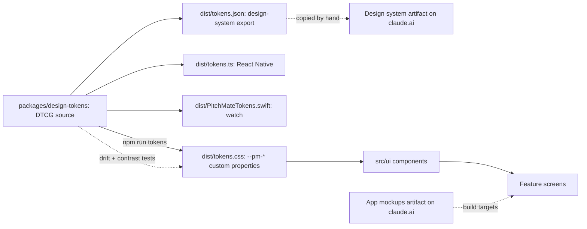

# 08 · Design

## Purpose

How PitchMate looks and sounds, and where that is defined: the brand rules, the shared design-tokens package, the two design artifacts on claude.ai, and the shared component library in `apps/web/src/ui`. Read this before building or restyling any screen. The detailed palette, type and voice rules live in `.claude/rules/brand.md` and are not repeated here; this chapter records how far the code follows them.

## Today (as-is)

### The chain of authority

| Line | Status | Detail | Source |
|---|---|---|---|
| The source of truth for tokens is a shared package in the repository | **Built** | DTCG source files in three tiers: primitive colour ramps, semantic tokens with a dark and a light value, and scales and component sizes; plus tokens only the apps use (springs, haptics) | `packages/design-tokens/tokens/semantic.tokens.json`, `packages/design-tokens/tokens/primitive.tokens.json`, `packages/design-tokens/scripts/build.mjs` |
| One build writes the web's CSS and the export the claude.ai design system reads | **Built** | 201 `--pm-` declarations on `:root, [data-theme='dark']` and `[data-theme='light']`; rebuilt with `npm run tokens` | `packages/design-tokens/dist/tokens.css`, `packages/design-tokens/dist/tokens.json`, `apps/web/package.json:13`, `apps/web/src/index.css:4` |
| The same build writes the phone's and the watch's values | **Partial** | Generated and drift-tested, but no app consumes them yet and the Swift file has not been compiled | `packages/design-tokens/dist/tokens.ts`, `packages/design-tokens/dist/PitchMateTokens.swift` |
| No built file can drift from the source | **Built** | A test renders every output again and compares | `apps/web/src/design/tokens.drift.test.ts` |
| Every documented colour pairing meets its contrast target in both themes | **Built** | | `apps/web/src/design/tokens.contrast.test.ts`, `apps/web/src/design/contrast.ts` |
| Keeping the claude.ai design system level with the repository | **Gap** | Its `project/tokens.json` is copied by hand from the built export and has not been updated since the overhaul changed tokens | `.claude/rules/brand.md` |

### Theme, type and assets

| Line | Status | Detail | Source |
|---|---|---|---|
| Dark mode is the primary target | **Built** | The root colour scheme is dark; a pre-paint script sets `data-theme`, defaulting to dark unless the system prefers light | `apps/web/src/index.css:13`, `apps/web/src/theme/themeBootstrap.ts:37`, `apps/web/vite.config.ts` |
| System / Dark / Light choice, remembered on the device | **Built** | In Settings only | `apps/web/src/theme/appearancePreference.ts`, `apps/web/src/features/app-shell/SettingsDestination.tsx` |
| Barlow (400–700) and Barlow Condensed (600, 700, 800, 800 italic), self-hosted | **Built** | No font is fetched from a third party | `apps/web/src/design/fonts.css`, `apps/web/src/design/fonts` |
| Logo marks in green, ink and white, plus the app icon | **Built** | | `apps/web/src/design/logos`, `apps/web/src/ui/Logo.tsx` |
| Icons are an inline SVG set | **Built** | | `apps/web/src/ui/icons.tsx`, `apps/web/src/ui/Icon.tsx` |
| Favicon and social share image | **Built** | | `apps/web/public/favicon.svg`, `apps/web/public/og-default.png` |
| App icons and a manifest for an installed app | **Gap** | See [04 · Devices](04-devices.md) | `apps/web/index.html` |

### The component library (`apps/web/src/ui`)

Everything is exported from one barrel (`apps/web/src/ui/index.ts`). All **Built**.

| Group | Components | Source |
|---|---|---|
| Actions and inputs | Button, IconButton, `buttonClasses`, TextField, Select, Checkbox, Toggle, Chip, OptionCard, ActionsMenu | `apps/web/src/ui/Button.tsx`, `apps/web/src/ui/TextField.tsx`, `apps/web/src/ui/Checkbox.tsx`, `apps/web/src/ui/Toggle.tsx`, `apps/web/src/ui/Chip.tsx`, `apps/web/src/ui/OptionCard.tsx`, `apps/web/src/ui/ActionsMenu.tsx` |
| Layout and navigation | Card, Tabs, SegmentedControl, TabNav, TopBar, Sidebar, Steps, Dialog | `apps/web/src/ui/Card.tsx`, `apps/web/src/ui/Tabs.tsx`, `apps/web/src/ui/TabNav.tsx`, `apps/web/src/ui/TopBar.tsx`, `apps/web/src/ui/Sidebar.tsx`, `apps/web/src/ui/Steps.tsx`, `apps/web/src/ui/Dialog.tsx` |
| Feedback | Banner, Toast, EmptyState, ErrorState, NotFoundState, Skeleton | `apps/web/src/ui/Feedback.tsx` |
| Identity | Avatar, the badges, Logo, GoogleMark, Icon | `apps/web/src/ui/Avatar.tsx`, `apps/web/src/ui/Badge.tsx`, `apps/web/src/ui/Logo.tsx`, `apps/web/src/ui/GoogleMark.tsx` |
| Squad and players | SquadCard, SquadCrest, PlayerRow, NotificationList | `apps/web/src/ui/Squad.tsx`, `apps/web/src/ui/PlayerRow.tsx`, `apps/web/src/ui/NotificationList.tsx` |
| Match | MatchCard, MatchStateChip, DayPicker, AvailabilityGrid, FairnessMeter, TeamColumn, Scoreboard, TeamSheet, BibFlag, EventTimeline | `apps/web/src/ui/Match.tsx`, `apps/web/src/ui/MatchState.tsx`, `apps/web/src/ui/AvailabilityGrid.tsx`, `apps/web/src/ui/TeamSheet.tsx`, `apps/web/src/ui/BibFlag.tsx`, `apps/web/src/ui/EventTimeline.tsx` |
| Stats | StatTile, LeaderboardRow, RatingChart, Rating, ResultBadge | `apps/web/src/ui/Stats.tsx`, `apps/web/src/ui/Rating.tsx`, `apps/web/src/ui/Result.tsx` |

### How well the features follow it

| Line | Status | Detail | Source |
|---|---|---|---|
| Every feature composes `src/ui` and reads `--pm-*` tokens | **Built** | No six-digit hex colour appears in any feature stylesheet | `apps/web/src/features`, `apps/web/src/ui/index.ts` |
| The UI kit has its own structural, behaviour and axe tests | **Built** | | `apps/web/src/ui/ui.structural.test.ts`, `apps/web/src/ui/components.test.tsx`, `apps/web/src/ui/ui.a11y.test.tsx` |
| Every exported component is used | **Partial** | Several are exported but used by no feature yet (Sidebar, SegmentedControl, Tabs, Toggle, Skeleton, SquadCrest, ResultBadge, the role, provisional and Pro badges, SettlingMark, LockedFeature). The signed-off mockups use all of them, so they stay | `apps/web/src/ui/index.ts` |
| No leftovers from the project template | **Built** | The Vite scaffold and its sample assets are gone and the web README describes the app | `apps/web/README.md`, `apps/web/src/main.tsx` |
| Screens match the mockups | **Partial** | Not verified screen by screen; the brand rule requires reading the mockup before building a screen | `.claude/rules/brand.md` |
| Phone and watch designs | **Partial** | Redone and signed off on 2026-11-13 in the app mockups artifact (19 boards); no client implements them | `.claude/rules/brand.md`, `apps/mobile/README.md`, `apps/watch/README.md` |

## To be

What is wanted, from [decisions](decisions.md). The design-system overhaul (2026-11-13) redid the mockups, moved the tokens into a shared package and added the kit pieces below. A **Partial** line here is designed, or built in the kit, but not yet on a screen.

| Line | Status | Decision |
|---|---|---|
| **A design-system overhaul redoes the app mockups**, phone and watch, and the redone mockups are the build targets for the apps the launch waits for. Done and signed off; nothing is built from them yet (`.claude/rules/brand.md`) | **Partial** | [Q4](decisions.md#q4), [R3](decisions.md#r3), [T12](decisions.md#t12) |
| **The overhaul uses the Higgsfield API where it fits**: brand imagery and promo animation. Tokens are built from `packages/design-tokens` and icons stay vector; neither comes from Higgsfield. Only brand material is sent to it. No imagery exists yet: the connector offered no generation tools on 2026-11-13, and the mockups hold labelled photo slots | **Gap** | [T12](decisions.md#t12) |
| **The design tokens are shared with the apps**: one source builds the web's CSS, a React Native output and a Swift output, so web and apps cannot drift. The outputs exist; no app consumes them yet (`packages/design-tokens/dist/tokens.ts`, `packages/design-tokens/dist/PitchMateTokens.swift`) | **Partial** | [R4](decisions.md#r4) |
| **The watch tracker is designed for the launch**, as the main live tracker, alongside the phone tracker. Designed: score face, scorer wheel, own-goal wheel, logged with undo (`.claude/rules/brand.md`) | **Partial** | [Q5](decisions.md#q5), [T10](decisions.md#t10) |
| **One account screen**: name, email (changeable), avatar, password, linked sign-in methods, notification preferences, signed-in devices, export, delete. It replaces the profile placeholder. Designed (`.claude/rules/brand.md`); not built | **Partial** | [Q17](decisions.md#q17), [R12](decisions.md#r12), [T15](decisions.md#t15) |
| **The rating with a "settling" note**: a number for every player that looks like every other rating, with the wave mark and a line of copy beside the player's name while it settles, and hollow marks on a dashed line in the progression chart. It replaces "~ Provisional" in place of a number, and does not rely on colour. The kit pieces are built (`apps/web/src/ui/Badge.tsx`, `apps/web/src/ui/Stats.tsx`); the screens still show the band because the API sends no number for a provisional rating | **Partial** | [T8](decisions.md#t8) |
| **The free roll**: a random split with swapping and no win %, the one balanced match a month and whether it has been used, and the way to upgrade. Designed (`.claude/rules/brand.md`); not built | **Partial** | [T1](decisions.md#t1), [U4](decisions.md#u4) |
| **The match-day options** screen for a Pro squad: availability on or off, payment tracking. Designed as the squad features screen (`.claude/rules/brand.md`); not built | **Partial** | [T4](decisions.md#t4), [U2](decisions.md#u2) |
| **Stats presentation**: every available stat shown usefully means a designed layout for the leaderboards and the player screen, not a longer list | **Gap** | [Q18](decisions.md#q18) |
| **A locked-feature state** for a Pro feature the squad does not have, distinct from "the admin has turned this off", with a way to upgrade. The kit pieces are built (`apps/web/src/ui/LockedFeature.tsx`, `apps/web/src/ui/Badge.tsx`); no screen uses them, since the server has no notion of a Pro squad | **Partial** | [Q2](decisions.md#q2), [R5](decisions.md#r5) |
| **Score confirmation screens**: enter the score, confirm or dispute it, "waiting for confirmation", and the admin's decision on a dispute | **Gap** | [Q11](decisions.md#q11), [R6](decisions.md#r6) |
| **The tracker without keeper changes**, on web, phone and watch, and the stats screens without the keeper-only stats. The phone and watch mockups have none (`.claude/rules/brand.md`); the web tracker and stats screens still do | **Partial** | [R13](decisions.md#r13), [T9](decisions.md#t9) |
| **Picking a tracker** for a match, and what the tracker sees | **Gap** | [R1](decisions.md#r1) |
| **Privacy policy and terms pages** follow the brand's plain voice (no cheek in privacy copy) | **Gap** | [Q8](decisions.md#q8) |

## Rules

The full rules are in `.claude/rules/brand.md`. The ones the code enforces mechanically:

- **Built** · Colours, type and radii come from `--pm-*` tokens, and spacing does wherever the scale has the value; components never use raw hex. `packages/design-tokens/dist/tokens.css`, `apps/web/src/ui/ui.structural.test.ts`
- **Built** · Everything in the tokens package's `dist/` is generated, never hand-edited. `apps/web/src/design/tokens.drift.test.ts`
- **Built** · Text meets WCAG 2.1 AA (4.5:1) in both themes, and focus rings, borders and icons meet 3:1. `apps/web/src/design/tokens.contrast.test.ts`
- **Built** · Never rely on colour alone (W/L/D marks, the settling words, the lock on a locked feature, team names, the word BIBS). `apps/web/src/ui/Result.tsx`, `apps/web/src/ui/Badge.tsx`, `apps/web/src/ui/LockedFeature.tsx`, `apps/web/src/ui/BibFlag.tsx`
- **Built** · A link that reads as a button uses `buttonClasses()`. `apps/web/src/ui/buttonClasses.ts`
- **Built** · Web UI extends `src/ui` rather than restyling inside a feature. `apps/web/src/ui/index.ts`

Rules that rest on review rather than a test: voice (friendly, a bit cheeky, sentence case, no cheek in errors or privacy copy, no emoji in chrome), uppercase display type, tabular numbers, and logo usage. **Partial** · `.claude/rules/brand.md`

## Open questions

Answered by the overhaul (2026-11-13): the artifact's token export was identical to the repository's before the overhaul, and the repository is now the source of truth; the unused components stay because the signed-off mockups use them; the template leftovers are removed; the brand rule's component list matches the kit; and the apps build their own components from the shared tokens. Still open:

1. **Half steps on the spacing scale.** The kit uses 6px, 10px and 14px about 55 times; the 4px scale has none of them, so they stay literals. Add `space-1-5`, `space-2-5` and `space-3-5`, or move those places onto the scale?
2. **Font sizes.** About 120 `font-size` values in the stylesheets are literals, because a type token is a whole style (weight, size, line height), not a size. Move them onto the type styles screen by screen, or add size-only tokens?
3. **The feature-private scales.** The squads and player-stats screens keep their own fluid spacing and type scales (`apps/web/src/features/squads/styles/squadsTokens.css`, `apps/web/src/features/player-stats/styles/playerStatsTokens.css`). They are relative units, so a browser text-size preference scales them, and tests pin their values. Fold them into the shared tokens, and if so as fluid values?
4. **Updating the claude.ai design system** from `packages/design-tokens/dist/tokens.json`: by hand after each token change, or automated?
5. **Brand imagery.** The mockups hold photo slots for Higgsfield. Which shots, and at what credit cost, once its generation tools are available?

## Ideas

- **Idea** · A living component gallery route (development only) rendering every `src/ui` component in both themes.
- **Idea** · An automated check that the committed `tokens.json` matches the artifact's export.
- **Idea** · Squad colours or a crest chosen by the owner, within the palette's contrast rules.
- **Idea** · A shareable team-sheet image in brand style for the group chat.
- **Idea** · Motion guidelines (goal celebration, "Dead even" delight) with reduced-motion fallbacks.
